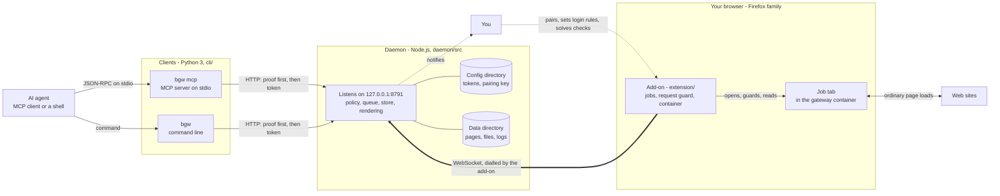
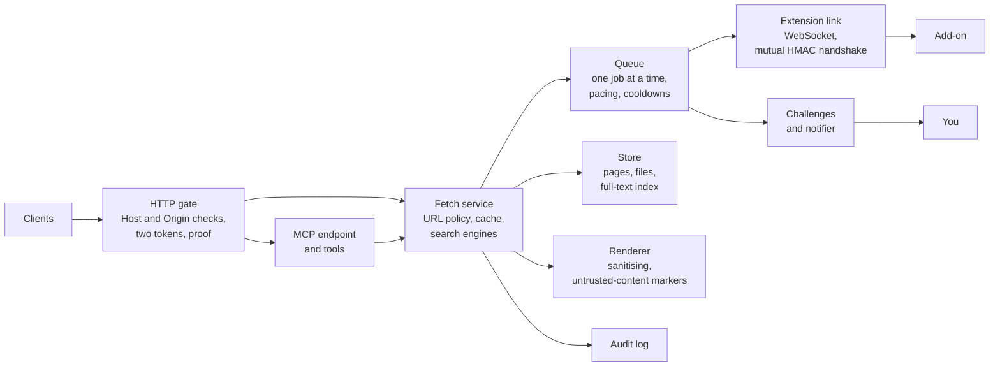
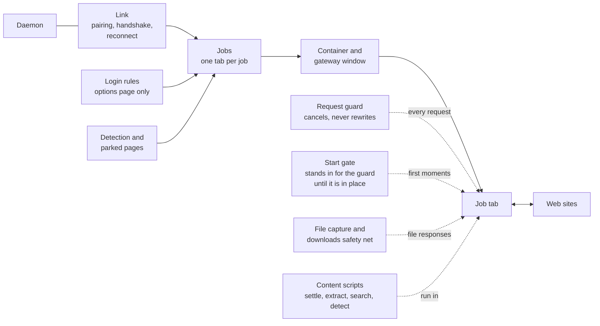
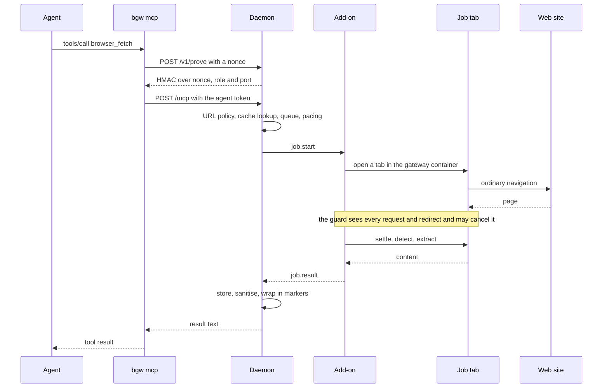
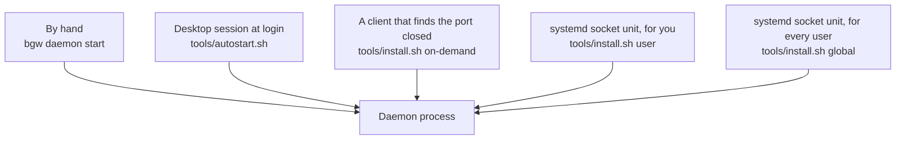

# Architecture

How the parts of RealBrowser MCP Gateway fit together, as of version 0.1.9.
What each part defends against is in [SECURITY-MODEL.md](SECURITY-MODEL.md);
this page says what the parts are and how a request travels through them.

## Components

The big picture first, then the inside of the two parts that do the work.

Read it left to right: an agent talks to a client, the client to the daemon,
the daemon to the add-on, the add-on to a tab, the tab to the web. Two things
go the other way on purpose. The add-on connects to the daemon, not the daemon
to the browser. And only you reach the options page, where pairing and the
login rules live. The daemon notifies you on the desktop when a page needs a
human.

Inside the daemon:

Inside the add-on:

| Part | Where | What it is |
|---|---|---|
| `bgw mcp` | `cli/bgw` | MCP server on stdio. Passes tool calls to the daemon after the daemon proved that it holds the token. Answers the handshake and the tool list itself. |
| `bgw` | `cli/bgw` | The same over a command line: `fetch`, `search`, `read`, `pages`, `export`, `status`, `doctor`, `pair`, `pending`, `open`. |
| Daemon controller | `cli/bgw_daemonctl.py` | Starts and stops the daemon as a plain process. Holds no way to a token. |
| HTTP gate | `daemon/src/http.js`, `secrets.js` | Loopback only. Checks `Host`, refuses `Origin` and `Sec-Fetch-Site`, separates the agent token from the admin token, answers `/v1/prove`. |
| MCP endpoint | `daemon/src/mcp.js`, `mcptools.js` | The five tools as JSON-RPC over HTTP. |
| Fetch service | `daemon/src/fetchsvc.js`, `search.js`, `site.js` | Applies the URL policy, answers from the store where it can, turns a search into a results-page job. |
| Queue | `daemon/src/queue.js` | One job at a time, per-site pacing, hourly budget, cooldown after a refusal, deadlines. |
| Extension link | `daemon/src/extlink.js`, `blobs.js` | One authenticated WebSocket to the add-on. Jobs go out, results and file pieces come back. |
| Renderer | `daemon/src/render.js` | Makes the text an agent gets: header lines made by the daemon, then the page content between markers with a random nonce. |
| Store | `daemon/src/store.js`, `files.js` | Pages and files on disk, an SQLite full-text index, retention, size caps, the export folder. |
| Challenges and notifier | `daemon/src/challenges.js`, `notify.js`, `daemon/helpers/notify_helper.py` | Keeps track of pages that wait for you and tells you on the desktop. |
| Audit log | `daemon/src/audit.js` | What was asked and how it ended. Never content. |
| Link | `extension/background/link.js`, `shared/auth.js` | Pairing, the handshake, reconnecting. |
| Jobs | `extension/background/jobs.js` | Opens a tab, waits for the page, collects the result, closes the tab. |
| Request guard | `extension/background/guard.js`, `shared/policy.js` | Cancels requests to private addresses and out-of-policy hops. Changes no request. |
| Start gate | `extension/background/gatefront.js`, `startgate.js` | Stands in for the request guard in the first moments after the add-on starts: holds the requests of containers until the browser has said which one is the gateway's, then removes itself. |
| Shared names | `extension/shared/suffixes.js` | Table of shared names (`co.uk`, `github.io`), used by the site key and the login rules. |
| Container and window | `extension/background/container.js`, `window.js` | The cookie container of the gateway and the one window jobs run in. |
| File capture | `extension/background/capture.js`, `downloads.js`, `shared/sniff.js` | Reads a file response inside the browser; removes any download a job page starts. |
| Detection and parked pages | `extension/background/detect.js`, `parked.js` | Recognises refusals and human checks; keeps a checked page open for you. |
| Login rules | `extension/background/optin.js`, `extension/options/` | The sites where your own session may be used. Set by hand only. |
| Content scripts | `extension/content/`, `extension/vendor/` | Run in the job tab: wait for the page to settle, extract with Defuddle, read search results. |

## One fetch, step by step

Variations on this path:

- **Search** is the same with a results page as the address and the search
  script as the extractor. Results are not stored.
- **A file** (PDF, CSV, archive) is read from the response by the add-on and
  sent to the daemon in pieces. The daemon looks at the first bytes (and at all
  of a file that begins like XML), stores it and returns an id; the bytes leave
  only through `export`.
- **A human check** that does not clear by itself parks the tab. The agent is
  answered `needs_human`, the queue moves on, and you get a notification. When
  you pass the check, the page is read and stored.
- **A site with a login rule** is loaded with your own cookie store instead of
  the container, is never scrolled, and is not stored.

## Who trusts whom

| From | To | What makes it safe to talk |
|---|---|---|
| Client | Daemon | The daemon proves that it holds the token before the client sends it. |
| Daemon | Client | Bearer token, 256 bits, read from a file only your user can read. |
| Add-on | Daemon | One-time pairing code, then a stored key; the daemon proves first on every connection, and the proofs name the port and both protocol versions. |
| Daemon | Add-on | The same handshake in the other direction; one add-on at a time. |
| Agent | Page content | It does not. Content arrives between markers and is to be treated as data. |
| Web page | Anything local | Nothing. It cannot call the daemon, and the guard cancels its requests to private addresses. |

## How the daemon gets started

The daemon is one process per user. Five ways lead to it; the README section
"Ways to start the daemon" compares them.

With the two systemd ways the port is held by systemd while the daemon is down
and the daemon runs in a sandbox. With the other three it is a plain process
and the port is free while it is down; the clients' proof step is what covers
that.

## Why there is no add-on for Chrome-family browsers

A version for Chrome, Chromium, Brave and Edge was considered and declined in
October 2026, for security reasons. The assessment below is from the published
documentation of Chrome's extension platform (Manifest V3). It was not measured
in a browser.

The security model of this project rests on four things the Firefox-family
add-on can do. A Chrome-family add-on installed the normal way can do none of
them in the same form:

| What the model needs | Firefox family | Chrome family, normal install |
|---|---|---|
| Keep agent pages away from your logins and keep their cookies between jobs | A cookie container of the gateway's own | No containers. Either an incognito window (cookies shared with your own incognito windows and gone when it closes) or a separate browser profile (then the login rules cannot work). |
| Cancel a request to a private address before it is sent, also when the address hides behind a name | Blocking request listener plus a DNS lookup | No blocking listener and no DNS lookup. Literal addresses can be blocked by rule; a name that resolves to a private address is only noticed after the request has gone out. |
| Read a file response inside the browser, so that nothing is saved because a page said so | Response filter on the job tab | No response filter. The file would have to go through the download manager and the disk, and be collected from there. |
| Keep the state of a running job and seal stray tabs at once | A background page that is always there | A background worker that the browser may stop and restart. |

An add-on installed by system policy keeps the blocking listener in Chrome, so
the second row could be met that way. It needs root on every machine, marks the
browser as managed, and still leaves the other three rows.

A Chrome-family version could therefore be built, but not with the properties
[SECURITY-MODEL.md](SECURITY-MODEL.md) describes. Shipping a weaker variant
under the same name would let people assume protections that are not there, so
the project does not ship one. If the platform changes - containers, a blocking
listener for ordinary add-ons, a response filter - the question is open again.

Not affected: the daemon, the clients and the page extractor do not depend on
the browser family. The extractor is tested in headless Chromium as well.
